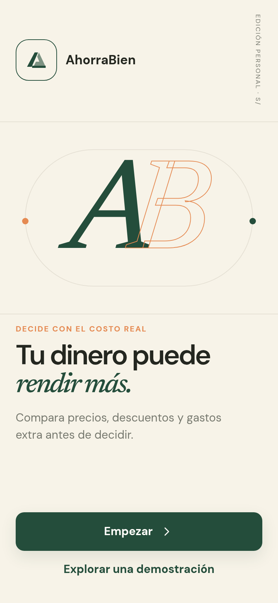
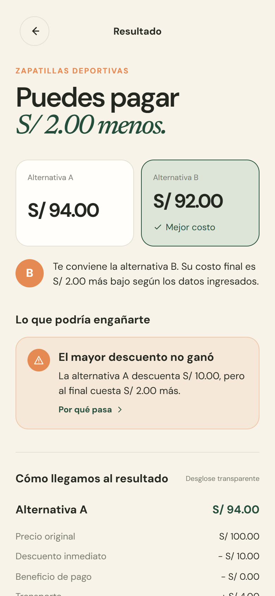
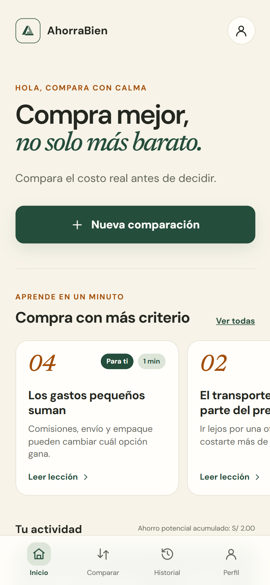
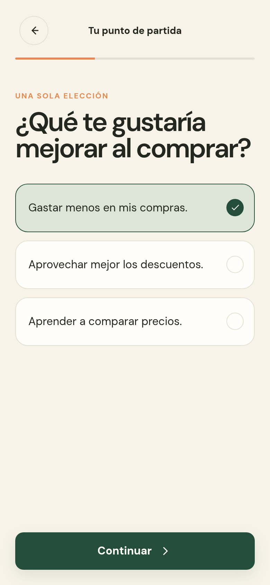
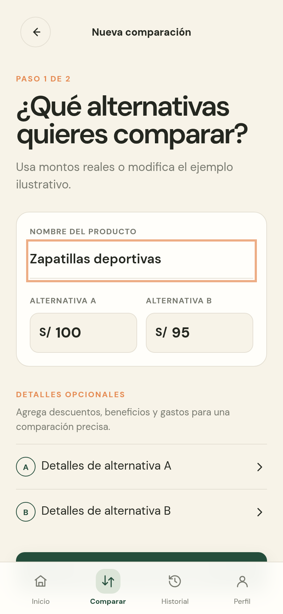
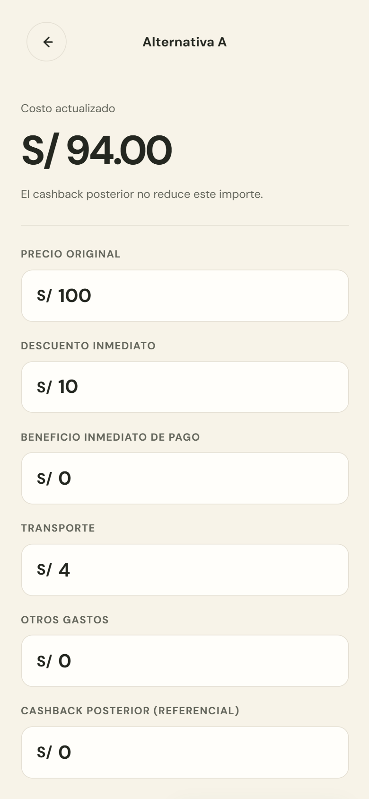
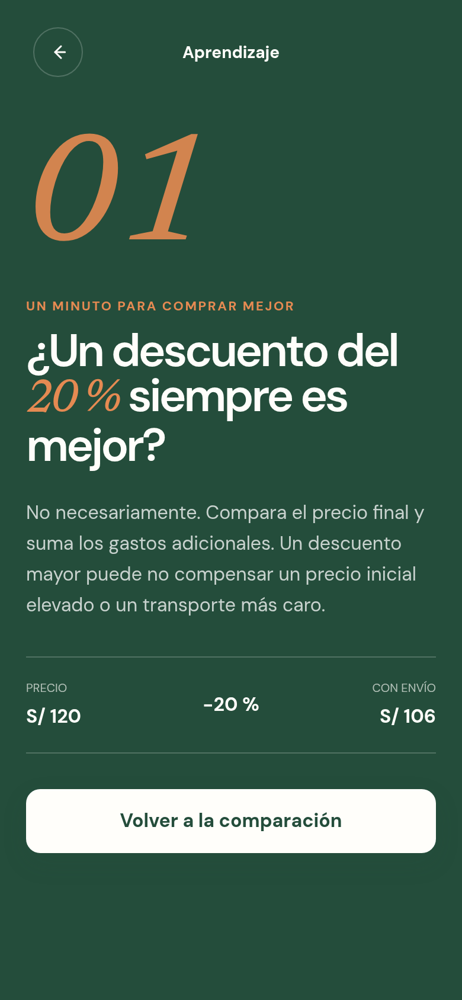
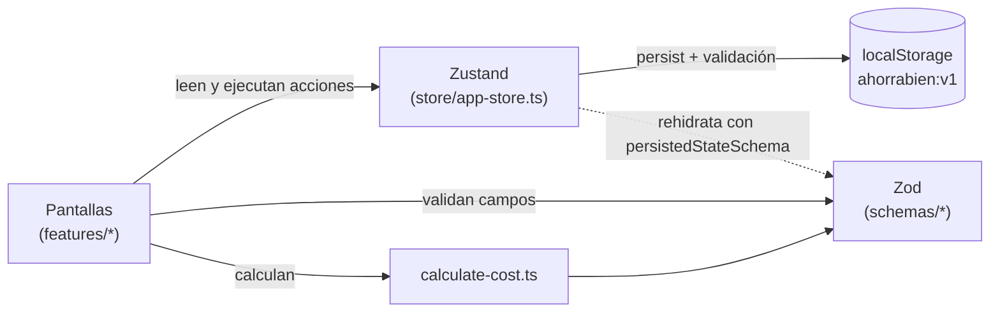

<div align="center">

# AhorraBien

**Compra mejor, no solo más barato.**

Compara el costo real de dos alternativas de compra en soles, sumando descuentos, beneficios de pago, transporte y gastos extra, antes de decidir.






</div>

## Tabla de contenidos

- [Presentación](#presentación)
- [Funcionalidades](#funcionalidades)
- [Cómo se calcula el costo real](#cómo-se-calcula-el-costo-real)
- [Capturas](#capturas)
- [Tecnologías](#tecnologías)
- [Requisitos](#requisitos)
- [Instalación](#instalación)
- [Scripts disponibles](#scripts-disponibles)
- [Estructura del proyecto](#estructura-del-proyecto)
- [Rutas de la aplicación](#rutas-de-la-aplicación)
- [Arquitectura](#arquitectura)
- [Pruebas y calidad](#pruebas-y-calidad)
- [Privacidad](#privacidad)
- [Contribuir](#contribuir)
- [Licencia](#licencia)

## Presentación

### El problema

Al comprar, solemos comparar solo el precio de la etiqueta o el porcentaje de descuento. Pero el precio final que pagamos incluye otros factores: el beneficio por pagar con cierta tarjeta, el costo de transporte o envío, comisiones y otros gastos. Un **descuento del 20 % puede salir más caro** que un producto sin descuento si la tienda queda lejos o el envío es costoso, y el cashback, que se recibe después, suele confundirse con un ahorro inmediato.

### La propuesta

**AhorraBien** es una aplicación web responsive, pensada primero para el celular y adaptada a tablet y escritorio, que:

1. Te deja ingresar **dos alternativas** de compra (A y B) con su precio y, si quieres, sus descuentos, beneficios de pago, transporte, otros gastos y cashback.
2. Calcula el **costo real** de cada una y te dice **cuál conviene y por cuánto**.
3. Muestra un **desglose transparente** para que entiendas de dónde sale el número.
4. Guarda tus comparaciones en un **historial** y suma tu **ahorro potencial acumulado**.
5. Incluye **lecciones de un minuto** con ejemplos resueltos en soles, a la vista desde el inicio, para comprar con más criterio.

Todo funciona en tu dispositivo: no hay cuentas, servidores ni datos bancarios.

## Funcionalidades

| Funcionalidad         | Descripción                                                                                                                                                                                                            |
| --------------------- | ---------------------------------------------------------------------------------------------------------------------------------------------------------------------------------------------------------------------- |
| Onboarding            | Eliges tu objetivo y lo que más te cuesta al comprar; se guarda en tu perfil.                                                                                                                                          |
| Demo guiada           | «Tu plan» resume qué haremos según tus respuestas y propone un ejemplo de lección adaptado a tu dificultad principal, que puedes probar en el comparador real. Sin respuestas, muestra un ejemplo genérico.            |
| Comparación A vs B    | Nombre del producto y precio de cada alternativa, con validación en tiempo real y mensajes de error accesibles.                                                                                                        |
| Detalles opcionales   | Descuento inmediato, beneficio de pago, transporte, otros gastos y cashback referencial.                                                                                                                               |
| Resultado             | Alternativa ganadora, diferencia en soles, recomendación, desglose de cada costo y estado «Guardada en tu historial» tras guardar.                                                                                     |
| Historial             | Comparaciones guardadas con fecha, resultado y diferencia; se pueden abrir o eliminar.                                                                                                                                 |
| Inicio                | Carrusel de lecciones, última comparación y ahorro potencial acumulado.                                                                                                                                                |
| Aprendizaje           | 4 lecciones (descuentos, transporte, cashback y gastos extra). Cada una muestra lo que parece, lo que realmente pasa, un ejemplo resuelto, la idea clave y cómo aplicarla; el ejemplo se puede abrir en el comparador. |
| Detector de ilusiones | El resultado avisa de lo que podría engañarte (el mayor descuento no ganó, los gastos se comen el descuento, el cashback llega después…) y prioriza lo que marcaste como difícil.                                      |
| Personalización       | Tus dificultades y tu objetivo ordenan las lecciones del inicio (con la insignia «Para ti») y resaltan esas filas en el desglose.                                                                                      |
| Lección sugerida      | El resultado recomienda la lección más útil según los datos de la comparación (p. ej. cashback).                                                                                                                       |
| Perfil                | Objetivo elegido, lo que más te cuesta (editables), moneda, cómo se calculan los costos e información de privacidad.                                                                                                   |
| Protección de cambios | Si sales del formulario con cambios sin guardar, se te pide confirmar.                                                                                                                                                 |

## Cómo se calcula el costo real

```
costo real = precio original
           − descuento inmediato
           − beneficio inmediato de pago
           + transporte
           + otros gastos
```

- El resultado se redondea a 2 decimales y nunca es negativo.
- El **cashback posterior** se muestra aparte y **no** reduce el costo, porque no es dinero que ahorras al momento de pagar.
- Una alternativa es válida si el precio es mayor que cero, ningún monto es negativo y la suma de descuento y beneficio no supera el precio.

**Ejemplo (demo):**

|                     | Alternativa A |   Alternativa B |
| ------------------- | ------------: | --------------: |
| Precio original     |     S/ 100.00 |        S/ 95.00 |
| Descuento inmediato |    − S/ 10.00 |               — |
| Beneficio de pago   |             — |       − S/ 5.00 |
| Transporte          |     + S/ 4.00 |       + S/ 2.00 |
| **Costo real**      |  **S/ 94.00** | **S/ 92.00** ✅ |

La alternativa B te ahorra **S/ 2.00**, aunque A tenía un descuento mayor.

## Capturas

|                                 Bienvenida                                 |                                 Onboarding                                 |                                        Comparar                                         |                                         Detalles                                          |
| :------------------------------------------------------------------------: | :------------------------------------------------------------------------: | :-------------------------------------------------------------------------------------: | :---------------------------------------------------------------------------------------: |
|  |  |  |  |

|                                Resultado                                 |                                Historial                                 |                               Inicio                               |                                Aprendizaje                                |
| :----------------------------------------------------------------------: | :----------------------------------------------------------------------: | :----------------------------------------------------------------: | :-----------------------------------------------------------------------: |
|  |  |  |  |

## Tecnologías

| Área         | Tecnología                                                      | Uso en el proyecto                                     |
| ------------ | --------------------------------------------------------------- | ------------------------------------------------------ |
| Framework    | [Next.js 16](https://nextjs.org/) (App Router, Turbopack)       | Rutas por pantalla, layouts, metadata y build estático |
| UI           | [React 19](https://react.dev/)                                  | Componentes y hooks                                    |
| Lenguaje     | [TypeScript 6](https://www.typescriptlang.org/) (modo estricto) | Tipado de todo el código                               |
| Estilos      | [Tailwind CSS 4](https://tailwindcss.com/)                      | Utilidades y tokens de diseño en `@theme`              |
| Estado       | [Zustand 5](https://zustand.docs.pmnd.rs/) + `persist`          | Estado global y persistencia en `localStorage`         |
| Validación   | [Zod 4](https://zod.dev/)                                       | Esquemas, mensajes de error y tipos inferidos          |
| Tipografías  | `next/font` (DM Sans y Newsreader)                              | Fuentes autoalojadas y optimizadas                     |
| Pruebas      | [Vitest](https://vitest.dev/) + Testing Library + jsdom         | Pruebas unitarias de lógica, esquemas y store          |
| Calidad      | ESLint (`eslint-config-next`) y Prettier (+ plugin de Tailwind) | Lint y formato consistente                             |
| Herramientas | pnpm 11, Node.js 22, [mise](https://mise.jdx.dev/)              | Gestión de dependencias y versiones                    |

## Requisitos

- **Node.js 22** o superior (lo fija el campo `engines` de `package.json`)
- **pnpm 11**

Si usas [mise](https://mise.jdx.dev/), las versiones correctas se instalan solas con el archivo `.mise.toml`:

```bash
mise install
```

Si no, puedes activar pnpm con Corepack, que usa la versión fijada en el campo `packageManager` de `package.json`:

```bash
corepack enable
corepack prepare pnpm@11.1.1 --activate
```

## Instalación

```bash
# 1. Clona el repositorio
git clone https://github.com/VictorMA18/AhorraBien.git ahorrabien
cd ahorrabien

# 2. Instala las dependencias
pnpm install

# 3. Inicia el servidor de desarrollo
pnpm dev
```

Abre [http://localhost:3000](http://localhost:3000). La interfaz se adapta al ancho de la ventana: en celular muestra una barra inferior, en tablet amplía márgenes y rejillas, y en escritorio (desde 1024 px) usa una barra superior. Usa el modo responsive del navegador para probar cada tamaño.

### Build de producción

```bash
pnpm build   # genera la versión optimizada en .next/
pnpm start   # sírvela en http://localhost:3000
```

> No se necesitan variables de entorno: la aplicación no usa servicios externos.

### Despliegue

Como todas las páginas se generan como contenido estático, la app se puede desplegar en [Vercel](https://vercel.com/) (importa el repositorio y listo) o en cualquier servidor con Node.js usando `pnpm build && pnpm start`.

## Scripts disponibles

| Script              | Descripción                                    |
| ------------------- | ---------------------------------------------- |
| `pnpm dev`          | Servidor de desarrollo con recarga en caliente |
| `pnpm build`        | Build de producción                            |
| `pnpm start`        | Sirve el build de producción                   |
| `pnpm typecheck`    | Verificación de tipos (`tsc --noEmit`)         |
| `pnpm lint`         | Análisis estático con ESLint                   |
| `pnpm test`         | Ejecuta las pruebas una vez                    |
| `pnpm test:watch`   | Pruebas en modo observador                     |
| `pnpm format`       | Formatea el código con Prettier                |
| `pnpm format:check` | Comprueba el formato sin modificar archivos    |

## Estructura del proyecto

```
ahorrabien/
├── docs/screenshots/        Capturas usadas en este README
├── public/                  Archivos estáticos (favicon)
├── src/
│   ├── app/                 Rutas (App Router), layouts y estilos globales
│   │   ├── (onboarding)/    Objetivo, dificultades y demo
│   │   ├── (app)/           Pantallas principales con navegación (barra inferior o superior)
│   │   ├── globals.css      Tailwind + tokens de diseño (@theme)
│   │   └── layout.tsx       Layout raíz: fuentes, metadata, contenedor de la app
│   ├── components/
│   │   ├── ui/              Componentes genéricos (Button, NumberField, ConfirmDialog…)
│   │   └── layout/          Estructura de pantalla (Screen, ScreenHeader, BottomNav…)
│   ├── features/            Pantallas y lógica por dominio
│   │   ├── comparison/      Formulario, detalles, resultado y cálculo de costos
│   │   ├── history/         Historial y tarjeta de última comparación
│   │   ├── home/            Pantalla de inicio
│   │   ├── learn/           Lecciones (contenido en lessons.ts) y sus pantallas
│   │   ├── onboarding/      Bienvenida, objetivo, dificultades y demo
│   │   └── profile/         Perfil y preferencias
│   ├── hooks/               Hooks compartidos
│   ├── lib/                 Utilidades (formato de moneda, cn)
│   ├── schemas/             Esquemas Zod
│   ├── store/               Store de Zustand y selectores
│   └── types/               Tipos inferidos de los esquemas
├── AGENTS.md                Guía técnica detallada para desarrolladores y agentes de IA
└── CLAUDE.md                Apunta a AGENTS.md
```

## Rutas de la aplicación

| Ruta                          | Pantalla                                            |
| ----------------------------- | --------------------------------------------------- |
| `/`                           | Bienvenida                                          |
| `/onboarding/objetivo`        | Paso 1: objetivo al comprar                         |
| `/onboarding/dificultades`    | Paso 2: qué dificulta elegir                        |
| `/demo`                       | Paso 3: ejemplo ilustrativo                         |
| `/inicio`                     | Inicio con actividad reciente                       |
| `/comparar`                   | Nueva comparación (producto y precios)              |
| `/comparar/a` · `/comparar/b` | Detalles opcionales de cada alternativa             |
| `/resultado`                  | Resultado y desglose                                |
| `/aprender`                   | Índice de lecciones                                 |
| `/aprender/[slug]`            | Lección (p. ej. `/aprender/cashback-llega-despues`) |
| `/historial`                  | Comparaciones guardadas                             |
| `/perfil`                     | Preferencias, privacidad y borrado del historial    |

## Arquitectura



- **Esquemas como fuente de verdad:** las reglas de validación y los tipos de TypeScript se derivan de Zod.
- **Lógica pura y probada:** el cálculo de costos no depende de React y tiene pruebas unitarias.
- **Persistencia segura:** los datos guardados se validan al cargar. Si están dañados se descartan con un aviso; si el navegador bloquea el almacenamiento, la app funciona en memoria y muestra una franja explicándolo. Los errores inesperados muestran una pantalla en español con «Reintentar» y «Volver al inicio».
- **Componentes por dominio:** cada carpeta de `features/` reúne sus pantallas, y las piezas reutilizables viven en `components/`.

Para convenciones de código, recetas (agregar pantallas o campos) y un mapa detallado de archivos, consulta **[AGENTS.md](AGENTS.md)**.

## Pruebas y calidad

```bash
pnpm typecheck && pnpm lint && pnpm test && pnpm build
```

Las pruebas cubren:

- **Cálculo de costos** (`calculate-cost.test.ts`): fórmula, redondeo, cashback, empates y casos inválidos.
- **Validación** (`comparison.schema.test.ts`): mensajes de error por campo y reglas del producto y las alternativas.
- **Lecciones** (`lessons.test.ts`): el ganador que afirma cada lección coincide con el cálculo real y el orden por preferencias.
- **Detector de ilusiones** (`detect-illusions.test.ts`) y **personalización** (`topics.test.ts`): cada alerta, su orden según el usuario y los campos resaltados.
- **Store** (`app-store.test.ts`, `safe-storage.test.ts`): guardar, abrir y eliminar comparaciones, persistencia, datos dañados, almacenamiento bloqueado y cuota llena.

## Privacidad

- Tus preferencias e historial se guardan **solo en tu navegador** (`localStorage`). La comparación que estás editando se conserva al recargar, solo en esa pestaña (`sessionStorage`).
- No hay registro, servidores, analítica ni recolección de datos personales o bancarios.
- Puedes borrar todo el historial desde **Perfil → Eliminar historial**.
- El sitio se publica con `noindex` para que no aparezca en buscadores.

## Contribuir

1. Crea una rama desde `main`: `git checkout -b feat/mi-cambio`.
2. Lee [AGENTS.md](AGENTS.md) para conocer la estructura y las convenciones.
3. Antes de abrir un PR, verifica que pasen `pnpm typecheck`, `pnpm lint`, `pnpm test` y `pnpm build`.
4. Usa mensajes de commit con el formato de [Conventional Commits](https://www.conventionalcommits.org/es/) (`feat:`, `fix:`, `docs:`, `chore:`…).

## Licencia

Distribuido bajo la licencia **MIT**. Consulta el archivo [LICENSE](LICENSE).
